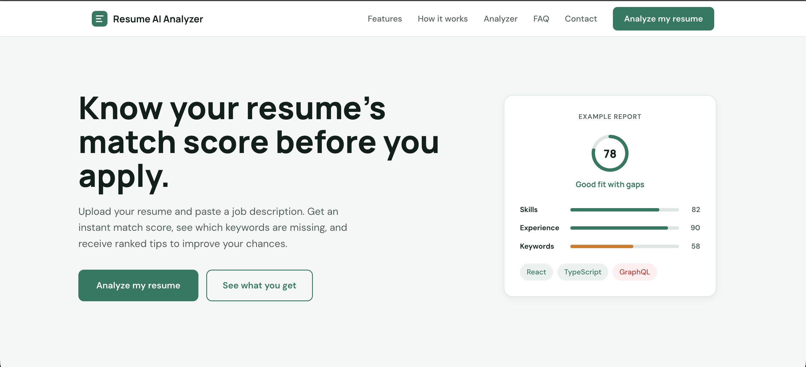
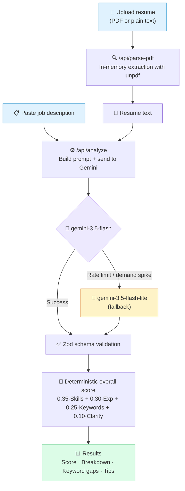

<div align="center">

# 📄 Resume AI Analyzer

**AI-powered resume analysis and job description matching.**
Upload a resume, paste a job description, and get an objective match score, keyword gap analysis, and ranked improvement tips.

[](https://your-app.vercel.app)
[](https://github.com/Sumit-sourabh45/AI-Resume-Analyser)


</div>

---

## 📑 Table of Contents

- [Live Demo](#-live-demo)
- [Screenshots](#-screenshots)
- [Key Features](#-key-features)
- [Tech Stack](#-tech-stack)
- [How It Works](#-how-it-works)
- [Scoring Architecture](#-scoring-architecture)
- [Getting Started](#-getting-started)
- [Project Structure](#-project-structure)
- [Deployment](#-deployment)
- [Privacy](#-privacy)
- [Author](#-author)

---

## 🌐 Live Demo

👉 **[Live website URL](https://airesumecorrection.vercel.app/)**


---

## 🖼️ Screenshots

| Landing Page |
| :---: |
|  | 


---

## ✨ Key Features

### 🎯 Calibrated, Unbiased Match Scoring
A 0–100 overall score, computed deterministically from four weighted categories:

| Category | Weight | What it measures |
| :--- | :---: | :--- |
| **Skills Match** | 35% | Demonstrated proficiencies vs. mandatory job requirements |
| **Relevant Experience** | 30% | Seniority level, responsibilities, and industry domain |
| **Keyword Coverage** | 25% | Strict ratio of matched requirements |
| **Resume Clarity** | 10% | Formatting, quantified achievements, and role relevance |

### 🔑 Categorized Keyword Gap Analysis
Strict set intersection prevents false matches.

- **Matched Keywords:** terms explicitly requested in the job description *and* demonstrated in the resume.
- **Missing Keywords:** required skills/tools absent from the resume, ranked **High / Medium / Low** with reasons.
- **Supported categories:** Programming & frameworks · Tools & platforms · Methods & concepts · Education & certifications.
- **Alternative List Intelligence:** handles "or" requirements (e.g. *Docker or Kubernetes*, *React or Vue*) so candidates aren't penalized when they show at least one equivalent.

### 💡 Ranked Improvement Tips
Prioritized (High / Medium / Low) recommendations that cite specific lines from your resume. Prompts enforce honest positioning templates, with no fabricated experience.

### ⚙️ Under the Hood
- **Serverless PDF Extraction:** in-memory text extraction with `unpdf`, preserving line breaks and structure without native C++ dependencies. Scanned/image-only PDFs are caught gracefully.
- **Cascading Model Fallback:** requests start with `gemini-3.5-flash` and automatically cascade to `gemini-3.5-flash-lite` on rate limits or demand spikes.
- **Copy Summary:** one click copies the full analysis (score, missing keywords, tips) as clean plain text.
- **Zero Data Retention:** in-memory processing only, with no database and no disk logging.

---

## 🧰 Tech Stack

<div align="center">

| Layer | Technology |
| :--- | :--- |
| **Framework** |  App Router + Turbopack |
| **Language** |  |
| **UI Library** |  |
| **AI & SDK** |  via `@google/genai` |
| **Validation** |  strict runtime JSON contracts |
| **PDF Parsing** | `unpdf` (Edge/serverless, web-standard) |
| **Styling** |  design tokens + CSS custom properties |
| **Typography** |  Manrope (headings) · DM Sans (body) via `next/font/google` |
| **Runtime** |  |
| **Hosting** |  |

</div>

---

## 🔄 How It Works




1. **Upload** a resume (PDF or plain text) and **paste** the target job description.
2. **Extract:** PDFs are parsed in memory by `unpdf`.
3. **Analyze:** Gemini evaluates each category independently; the response is validated against a Zod schema.
4. **Score:** the overall score is computed in code, not by the model.
5. **Review** the score, category breakdown, keyword gaps, and ranked tips.

---

## 🧮 Scoring Architecture

To eliminate LLM sycophancy and grade inflation, the model scores each category independently and the overall score is calculated deterministically:

```text
Overall Score = round( 0.35 × Skills
                     + 0.30 × Experience
                     + 0.25 × Keywords
                     + 0.10 × Clarity )
```

- **Keywords score:** the true ratio of matched required terms to total stated requirements.
- **Set intersection:** a term counts as "matched" only if it was explicitly required in the job description *and* demonstrated in the resume.

---

## 🚀 Getting Started

### Prerequisites

- **Node.js** 18.17 or later
- A **[Google Gemini API key](https://aistudio.google.com/app/apikey)**

### Installation

```bash
# 1. Clone the repository
git clone https://github.com/Sumit-sourabh45/AI-Resume-Analyser.git
cd AI-Resume-Analyser

# 2. Install dependencies
npm install
```

### Environment Variables

Create a `.env.local` file in the project root:

```env
GEMINI_API_KEY=your_google_gemini_api_key_here
```

### Run

```bash
npm run dev
```

Open [http://localhost:3000](http://localhost:3000) in your browser.

### Scripts

| Command | Description |
| :--- | :--- |
| `npm run dev` | Start the development server (Turbopack) |
| `npm run build` | Create a production build |
| `npm start` | Run the production build |
| `npm run lint` | Lint the codebase |

---

## 🗂️ Project Structure

```text
resume-ai/
├── app/
│   ├── api/
│   │   ├── analyze/
│   │   │   └── route.ts          # Gemini AI evaluation with Zod schema & fallback
│   │   └── parse-pdf/
│   │       └── route.js          # In-memory PDF text extraction using unpdf
│   ├── components/
│   │   ├── Navbar.tsx            # Sticky top navigation with smooth scroll
│   │   ├── Hero.tsx              # Landing hero with example report preview
│   │   ├── Features.tsx          # 6-card feature grid
│   │   ├── HowItWorks.tsx        # 3-step workflow guide
│   │   ├── ScoreCard.tsx         # Circular SVG score ring & calculation notes
│   │   ├── BreakdownList.tsx     # Color-coded progress bars by category
│   │   ├── KeywordPanel.tsx      # Matched & missing keyword chips by category
│   │   ├── TipsList.tsx          # Priority-ranked actionable tips with quotes
│   │   ├── AnalysisSkeleton.tsx  # Responsive loading skeleton layout
│   │   ├── ErrorState.tsx        # User-friendly error message with retry button
│   │   ├── FAQ.tsx               # Interactive accordion FAQ
│   │   ├── ContactForm.tsx       # Contact section with email & form confirmation
│   │   └── Footer.tsx            # Navigation links and disclaimer
│   ├── lib/
│   │   └── analysis-schema.ts    # Zod validation schema & TypeScript types
│   ├── favicon.ico               # Multi-resolution optimized favicon
│   ├── globals.css               # Design tokens, base typography, and focus states
│   ├── layout.tsx                # Next.js root layout with font definitions
│   ├── page.tsx                  # Main client view (inputs, state, results)
│   └── page.module.css           # Responsive layout rules & input styling
├── next.config.ts                # Serverless external package configuration
├── package.json
└── tsconfig.json
```

---

## ☁️ Deployment

Optimized for **Vercel Serverless**:

1. Push your repository to GitHub.
2. Import the project in [Vercel](https://vercel.com/new).
3. Under **Settings → Environment Variables**, add:
   - `GEMINI_API_KEY`: your Google Gemini API key
4. Click **Deploy**.

---

## 🔒 Privacy

Resume Analyzer uses **zero data retention**. Files and text are processed in memory only. Nothing is stored in a database or written to disk. Note that the resume and job description text are sent to the Google Gemini API for analysis.

---

## 👤 Author

**Sumit Sourabh**

[](https://github.com/Sumit-sourabh45)

---

<div align="center">

⭐ If you found this project useful, consider giving it a star!

</div>